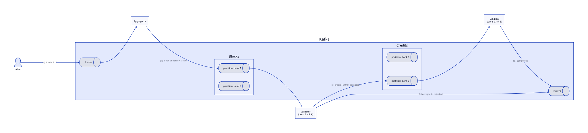

# Architecture

An overview of the system designed in the [thesis](../thesis/). Each part has its own document with the details:

| Topic | Document |
|---|---|
| How funds are represented (account, UTXO, credit model) | [credit-model](../credit-model/) |
| How trades are routed to partitions, and why | [partitioning](../partitioning/) |
| The Sequential and Concurrent models | [models](../models/) |
| Exactly-once processing, eventual consistency, the shared balance map | [consistency](../consistency/) |
| Messages and schemas | [data-model](../data-model/) |
| How the cluster runs locally | [deployment](../deployment/) |

Both implementations, in [`java/`](../../java/) and [`go/`](../../go/), follow these documents and can be mixed in one cluster. How to run them is in [running](../running/). If code and docs disagree, fix one of them.

## The problem

Processing payments in parallel risks **dirty writes**. If two processors both read Alice's balance as $100 and apply +$5 and +$10 independently, the final balance is $105 or $110 instead of $115. Locks fix this but add steps and latency to every trade.

## The idea

1. **Decouple each trade** into a *validation* phase (the sender's balance is checked and deducted) and a *credit* phase (the receiver's balance is increased). See [credit-model](../credit-model/).
2. **Give every balance exactly one owner.** Each bank maps to one Kafka partition, and so to one validator. No two processors ever write the same balance, so no locks are needed between processors. See [partitioning](../partitioning/).
3. **Let Kafka carry everything between steps**, with Kafka transactions for exactly-once processing. See [consistency](../consistency/).

## Topics

| Topic          | Contents                                                           |
|----------------|--------------------------------------------------------------------|
| `trades`       | Incoming trades (and, in the Sequential model, credits sent back)  |
| `blocks`       | Batches of trades for the same bank                                |
| `credits`      | Credit records waiting to be applied (Concurrent model only)       |
| `orders`       | Results: accepted/rejected after validation, then "completed" after credit |
| `localBalance` | Latest balance per account, used to rebuild state after a failure or rebalance |
| `validatorOffsets` | How far each bank's validator has read `blocks` and `credits`, written together with its results |
| `accountInfo`  | Banks, their partitions and accounts, and the model the cluster runs; written by `init` |

How each topic is partitioned is in [partitioning](../partitioning/#topic-partitioning).

## Processors

- **Trade generator:** produces trades into `trades`. In practice these come from banks' servers, not individual account holders.
- **Aggregator** (layer 1): consumes `trades`, groups new trades by sender bank and, in the Sequential model, credits by receiver bank. It emits a block to that bank's partition of `blocks` when the block reaches the **block size** or after a **timeout**. A block also stays under 512 KiB, so that it, and every record a validator makes from it, fits within Kafka's 1 MiB message limit. Blocks cut down the number of Kafka round trips.
- **Validator** (layer 2): owns a set of banks and keeps their balances in memory. It validates trades, applies credits, writes results to `orders`, and backs up balances to `localBalance`, all inside Kafka transactions.

Processors never talk to each other directly. All communication goes through Kafka, which keeps Kafka's consistency guarantees intact.

Two helper roles complete the system: **`init`** creates the topics, the banks and their starting balances, and **`report`** reads the results back and checks them (every trade validated once, every credit applied once, no money created or lost). See [running](../running/).

## Lifecycle of a trade

Source: [`diagrams/trade-lifecycle.d2`](diagrams/trade-lifecycle.d2) (Concurrent model shown)

Example: Alice (bank A) sends $10 to Bob (bank B).
1. The trade is produced to `trades`.
2. An aggregator puts it in a block with other bank-A trades and sends it to bank A's partition of `blocks`.
3. Bank A's validator checks that Alice has at least $10:
   - **Rejected:** a record goes to `orders`, and the trade ends.
   - **Accepted:** Alice −$10, backed up to `localBalance`. An "accepted" record goes to `orders`, and a credit goes to bank B. How the credit travels depends on the [model](../models/).
4. Bank B's validator adds +$10 to Bob, backs it up, and sends a "completed" record to `orders`.

## Glossary

| Term          | Meaning                                                                       |
|---------------|-------------------------------------------------------------------------------|
| Trade         | A payment from one account to another. The thesis avoids "transaction" for this. |
| Transaction   | Only ever a **Kafka** transaction.                                            |
| Credit        | The receiving half of an accepted trade, waiting to be added to a balance.    |
| Block         | A batch of trades for one bank, made by an aggregator: at most the block size, and at most 512 KiB. |
| Order         | A result record: rejected, accepted, or completed.                            |
| Bank          | A group of accounts owned by one partition, and so by one validator.          |
| Site          | One bank's infrastructure: a Kafka node, an aggregator, a validator.          |
| RPS / TPS     | Requests per second offered / trades per second actually processed.          |
