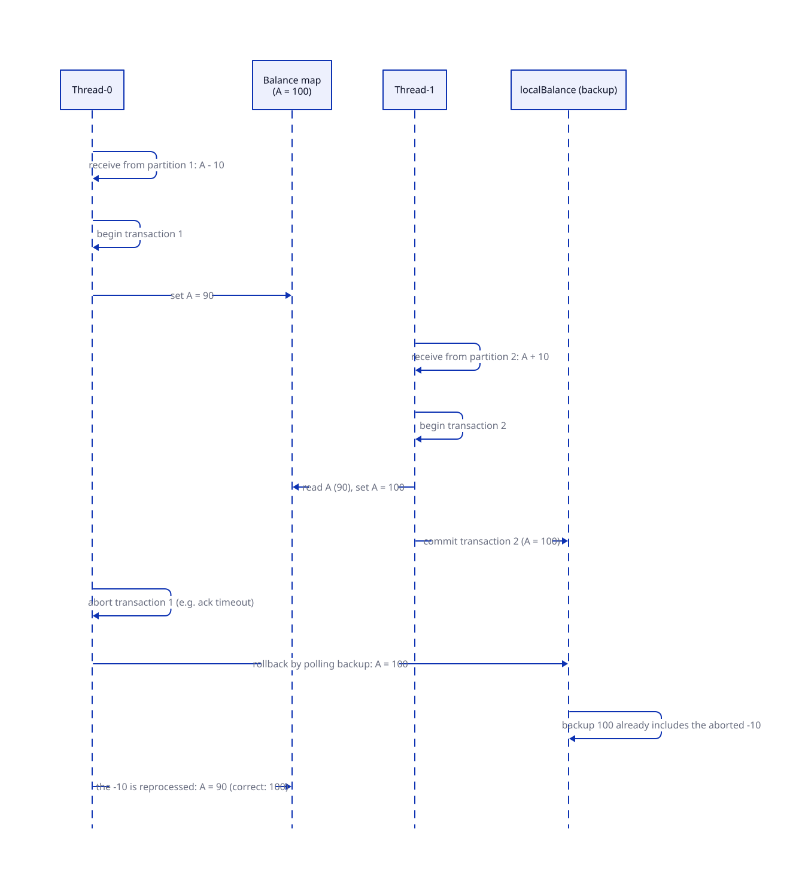
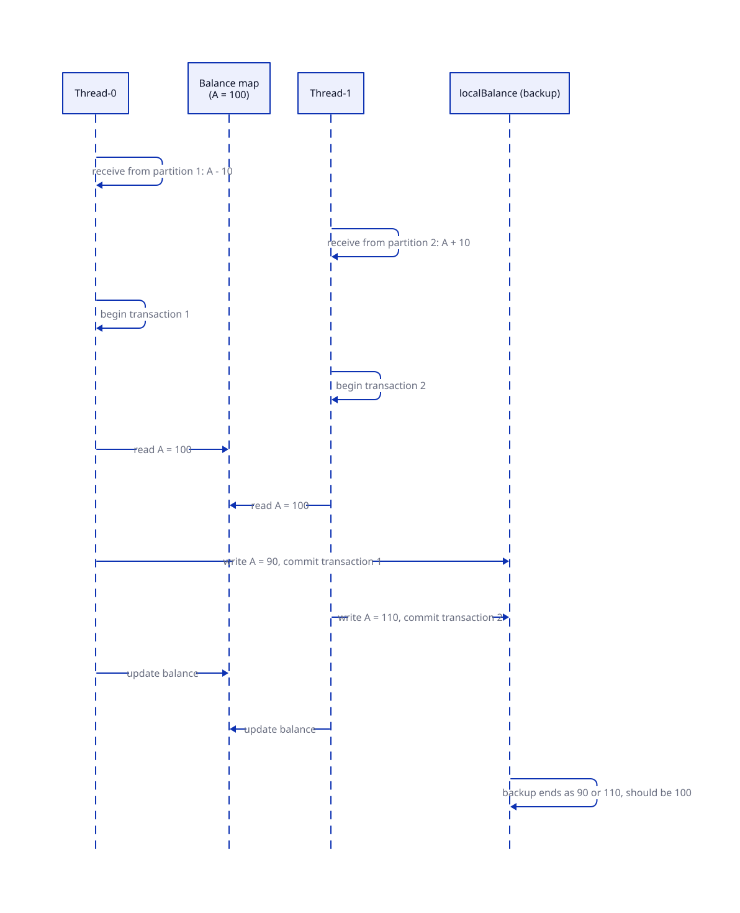

# Consistency

What the system guarantees, how, and the pitfalls found while building it (thesis §4.1.2, §4.4, §5.1).

## Goals

- **No lost trades:** every record is sent and acknowledged at least once at every step.
- **No double spending:** every trade is processed at most once.
- Together: **exactly once**, even when brokers or processors fail.

## Exactly-once processing through Kafka

Rather than solve these problems by hand, the system relies on Kafka:

- **Kafka transactions** combine an idempotent producer with atomic writes. A validator's reads (consumer offsets) and all its writes (`orders`, `credits` or `trades`, `localBalance`) commit or abort together.
- **Replication and consumer groups** keep processing going when some brokers or processors fail.
- **Processors never communicate directly.** All inter-layer traffic goes through Kafka, so its guarantees cover every hop. Inter-thread communication inside a processor turned out to be risky too (see below).

Kafka's transaction protocol is a two-phase commit: the producer registers with a transaction coordinator, which tracks state in an internal topic. On a LAN it adds little overhead. With high network latency it costs noticeably more (see [models → Concurrent w/o Tx](../models/#concurrent-wo-tx)).

## Eventual consistency

The [credit model](../credit-model/) splits a trade into validation and credit, so a receiver's balance is updated **some time after** the sender's. Immediate consistency, as in an account model, isn't achievable. **Eventual** consistency is: every accepted trade's credit is eventually applied exactly once. Without congestion, the gap is small.

## Ordering

- **Linearizability is impossible:** trades are processed in parallel groups with no global order.
- **Serializability is achievable**, ignoring the possibility of negative balances.
- **The `orders` topic** gets a record after validation *and* after credit. This gives real-time feedback ("accepted") while still marking full completion. Validators can write `orders` in parallel when it's partitioned by bank, at the cost of inter-bank serializability.

## Recovery

Each validator continuously backs up its balances to `localBalance` within the same Kafka transaction as its other writes. After a crash or rebalance, the new owner of a bank rebuilds that bank's balances from `localBalance`, then continues from the last committed offsets.

## The shared balance map

In the [Concurrent model](../models/#concurrent-model), a validator has two threads, one for `blocks` and one for `credits`, which share one in-memory balance map and the `localBalance` backup. Two approaches failed before the final design.

### Attempt 1: update the map inside the Kafka transaction → dirty write

Thread 0 deducts A −10 inside transaction 1 and updates the map to 90. Thread 1 then credits A +10 and commits transaction 2, recording 100. Transaction 1 then **aborts**, for example on an acknowledgement timeout. The trade will be reprocessed, but the committed backup already includes its effect. If the abort comes from a thread crash, there is no way to undo it.

### Attempt 2: update the map after the Kafka transaction → race condition

Both threads read A = 100 from the map, and each writes its own result (90 or 110) to the backup during its transaction. The last commit wins, and the backup shows 90 or 110 instead of 100. Updating the map and the backup isn't atomic.

Java's `ConcurrentHashMap` doesn't help: it makes single operations thread-safe, not a read–transaction–write sequence.

### Final design: lock per Kafka transaction

The balance map is **locked for the duration of each Kafka transaction**. This is correct, but the two threads no longer process in parallel. The Concurrent model is still worth it: credits get their own queue and need fewer network steps (see [models](../models/)).

Diagram sources: [`dirty-write.d2`](diagrams/dirty-write.d2), [`race-condition.d2`](diagrams/race-condition.d2) (thesis Fig. 5.1, 5.2)
