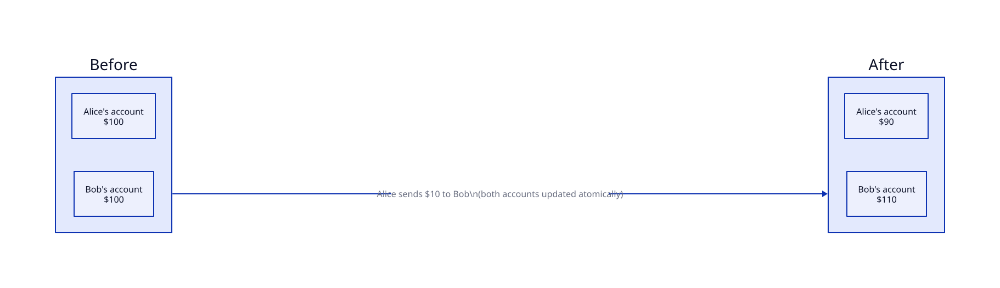
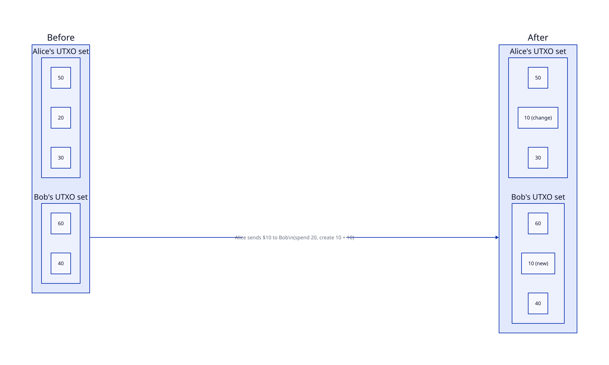
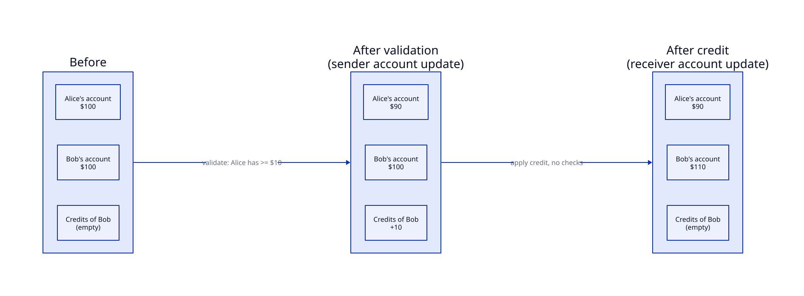

# Credit model

How user funds are represented. This is the core idea of the thesis (§2.2, §3.1).

## Two common models

Example used throughout: Alice sends $10 to Bob.

### Account model

Each account holds a balance. A trade checks the sender's balance and updates both accounts **atomically**. It's simple, and used by traditional banks and Ethereum, but concurrent trades on the same account need locks, which limits parallelism.

### UTXO model

Funds are discrete *unspent transaction outputs*. A trade spends a UTXO that's big enough, and creates new UTXOs for the receiver and for the change. UTXOs can be processed in parallel, but there is no running balance, and paying more than one UTXO holds means combining several. Used by Bitcoin, e-CNY and Project Hamilton.

## The credit model

The credit model keeps **account balances**, but splits each trade into two phases:

1. **Validation (sender account update).** The sender's validator checks the balance and deducts the amount. Only this half needs validation, which is the same advantage UTXO has.
2. **Credit (receiver account update).** An accepted trade produces a **credit** item for the receiver. The receiver's validator later adds it to the balance with no checks, because validation already happened.

| | Account | UTXO | Credit model |
|---|---|---|---|
| Running balance per account | ✅ | ❌ | ✅ |
| Locks needed for concurrent trades on one account | ✅ | ❌ | ❌ ([one owner per balance](../partitioning/)) |
| Multiple inputs to pay a larger amount | ❌ | ✅ | ❌ |
| Consistency | Immediate | Immediate | **Eventual** |

## The trade-off: eventual consistency

Between the two phases, the money has left Alice but hasn't reached Bob yet. Balances are therefore **eventually consistent**. Without congestion, the gap is short and results are very close to an account model (thesis §4.4). Details are in [consistency](../consistency/).

## Why not benchmark against the other two?

The thesis deliberately doesn't (§2.2). A UTXO system has real-world restrictions that would need a special setup, and an account system's structure is so different from streaming that no fair, like-for-like experiment exists. The comparison stays theoretical.

## Diagrams

Sources: [`account-model.d2`](diagrams/account-model.d2), [`utxo-model.d2`](diagrams/utxo-model.d2), [`credit-model.d2`](diagrams/credit-model.d2) (thesis Fig. 2.1, 2.2, 3.1).
