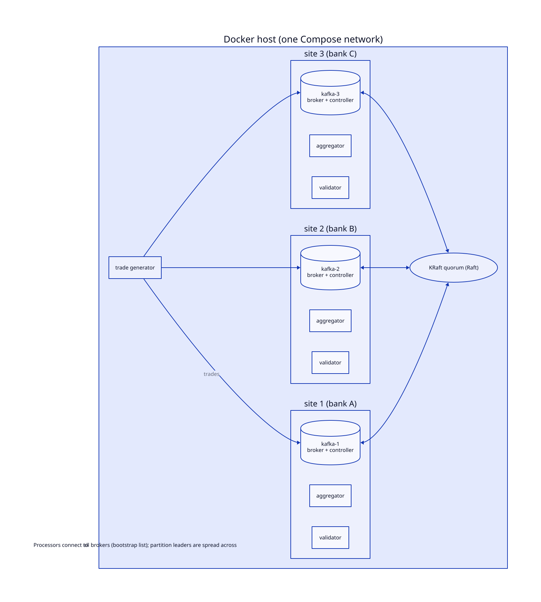

# Deployment

Everything runs on **one Docker host** with Docker Compose. The goal is a runnable system that shows the real distributed topology, not reproducing the thesis's throughput numbers. How to start it is in [running](../running/).



Source: [`diagrams/deployment.d2`](diagrams/deployment.d2)

## Sites

A **site** is one bank's infrastructure: one Kafka node, one aggregator and one validator. This follows the thesis's vision that each bank hosts its own broker, aggregator and validator (§4.1.1). The trade generator and the two helper roles, `init` and `report`, are separate.

## Kafka in KRaft mode

Kafka nodes use **KRaft**, with no ZooKeeper. A node can be:
- a **broker**, which stores data and serves clients
- a **controller**, which manages cluster metadata (topics, partition leaders, live brokers) and agrees on it through a Raft quorum
- **both** (*combined*)

Raft needs a majority of controllers to agree, so 3 controllers tolerate the loss of 1. An even number doesn't add anything: 4 controllers need 3 for a majority, so they also tolerate the loss of only 1, and 2 controllers tolerate none. `infra/generate-compose.sh` prints a note when you choose an even number.

## Defaults

All settings are configurable.

| Setting | Default | Meaning |
|---|---|---|
| `SITES` | 3 | Number of sites, which means Kafka nodes, aggregators and validators |
| `CONTROLLERS` | 3, or `SITES` if smaller | The first N Kafka nodes are combined broker + controller, the rest are pure brokers |
| `REPLICATION_FACTOR` | 1 | Replication for all topics, including Kafka's internal ones (the thesis used 1) |
| Banks, `trades` partitions | = `SITES` | One bank (one partition) per validator, and one `trades` partition per aggregator. `BANK_COUNT` and `TRADES_PARTITIONS` change them for a run (see [running](../running/#with-docker-compose)). |

3 is the smallest cluster that is genuinely distributed with a real Raft majority.

With replication, the Compose file has Kafka record the state of a Kafka transaction only while 2 replicas of that state are in sync. A replication factor of 2 therefore favours durability over availability: while one node is down, every Kafka transaction whose state that node replicates stops, and the aggregators and validators that use them fail and restart until the node is back. A replication factor of 3 keeps transactions going with one node down. The app's own topics keep Kafka's default `min.insync.replicas` of 1, so writes to them go on while a single replica is in sync.

## The Compose file

[`infra/generate-compose.sh`](../../infra/generate-compose.sh) writes [`infra/docker-compose.yml`](../../infra/docker-compose.yml). The committed file is its output for the defaults. Regenerate it to change the cluster's shape:

```sh
SITES=4 CONTROLLERS=1 infra/generate-compose.sh
```

Kafka keeps its data inside each node's container, not in volumes. So `docker compose -f infra/docker-compose.yml --profile tools down -v` deletes the cluster with all its data, and the next `up` starts with empty topics.

| Service | What it runs |
|---|---|
| `kafka-1` … `kafka-N` | Kafka nodes, reachable from the host on `localhost:9092`, `9093`, … (one port per node) |
| `init` | `dp init` once, after all brokers are healthy |
| `aggregator-i`, `validator-i` | One of each per site, started after `init` succeeds, restarted if they exit with an error |
| `generator`, `report` | Not started by `up`; run on demand with `docker compose run` |

## How settings are applied

| What | Where |
|---|---|
| Cluster shape (`SITES`, `CONTROLLERS`, `REPLICATION_FACTOR`) | The generator script. In combined mode the controller list depends on the node count, so it's generated. |
| Topic settings (partitions, replication) | The app's `init` role creates topics from the app config, which the Compose file sets per cluster shape, and from `BANK_COUNT` and `TRADES_PARTITIONS` if they are set |
| Per-container settings (role, site ID) | Environment variables in the Compose file (`DP_SITE_ID`, …), overriding the app's [configuration](../running/#configuration) |
| Per-run choices: model, transactions, which implementation | Environment variables when you run Compose: `MODEL`, `KAFKA_TRANSACTIONS`, `IMPL`, … (see [running](../running/#with-docker-compose)). Every variable has a default in the Compose file. |

## Limits of a single host

- All nodes share one machine's CPU, so more brokers **don't add capacity**.
- What multiple nodes do give you: partition leadership spread across nodes, per-site network delay (`tc netem`, closer to geographic distribution than the thesis's whole-NIC delay), and per-site CPU limits (the closest local equivalent of the thesis's high-end vs lower-spec machines).
- Kafka's own failover is out of scope. The system relies on Kafka's guarantees rather than testing them.
