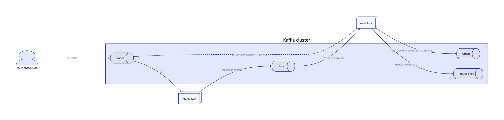
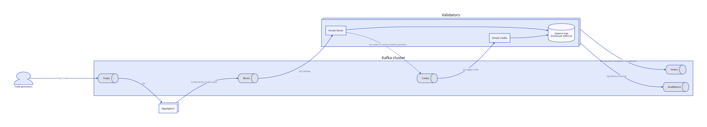

# Models

The thesis builds two models on the same foundation ([architecture](../architecture/), [partitioning](../partitioning/)). They differ in one thing only: **how a credit travels from the sender's validator to the receiver's validator** (thesis §4.2, §4.3).

| | Sequential | Concurrent |
|---|---|---|
| Credits travel via | Back into `trades` → aggregated → `blocks` | A dedicated `credits` topic |
| Validator reads | `blocks` only | `blocks` and `credits` (two threads) |
| Network steps per trade | 9 | 7 |
| Credits wait behind new trades | Yes | No |
| Peak TPS (LAN, thesis) | ~230k | ~200k |
| Under overload / network delay | Degrades faster | More stable; >2× Sequential's TPS at 100 ms delay |

## Sequential model

Source: [`diagrams/sequential-model.d2`](diagrams/sequential-model.d2) (thesis Fig. 4.1)

(a) A trade is sent to `trades`. (b) An aggregator picks it up. (c) The aggregator groups it into a block by bank and sends it to `blocks`. (d) A validator reads the block:
- **Insufficient funds:** the trade is marked rejected and sent to `orders` (f).
- **Validated:** the sender's balance is updated (and backed up to `localBalance`, g). The validated trade goes to `orders` (f), and its **credit is sent back to `trades`** (e) with category *receive*.

The credit then flows like any trade: it's aggregated, lands in the receiver bank's partition of `blocks`, and the receiver's validator (d) adds it without checks, sends the completing record to `orders` (f), and updates the backup (g).

- **Pros:** the simplest design, since validators read one topic. Highest peak throughput on a LAN.
- **Cons:** credits queue behind unvalidated trades, so completion gets slow when RPS exceeds TPS. More network steps, so it suffers more from latency.

## Concurrent model

Source: [`diagrams/concurrent-model.d2`](diagrams/concurrent-model.d2) (thesis Fig. 4.2)

Same as the Sequential model up to validation. At step (e), the credit goes **directly to `credits`**, to the receiver bank's partition. Each validator runs **two consumer threads**, one on `blocks` and one on `credits`, both assigned the same banks.

The thesis first tried a single thread that switched between the two topics every few seconds (e.g. 10 s). Reconnecting to Kafka that often was too expensive, which led to the two-thread design.

- **Pros:** credits don't wait behind new trades, so trades complete sooner and the system stays stable under overload. Fewer network steps, so it is more resilient to network delay.
- **Cons:** the two threads share the balance map. Without care, that causes dirty writes and races, so the map is **locked for the duration of each Kafka transaction**. The threads therefore don't actually process in parallel; the gain comes from the separate queue and fewer steps. See [consistency → the shared balance map](../consistency/#the-shared-balance-map).

## Concurrent w/o Tx

The Concurrent model with Kafka transactions turned off. It **isn't consistent** and exists only to measure what Kafka transactions cost:
- On a LAN, it was **not faster**: Kafka transactions add no significant overhead with small network delay.
- At 100 ms simulated delay, transactions cost noticeably more, as expected from a two-phase commit that needs extra round trips.

## Thesis results in short

Two laptops (i7-12700H), each running a broker, an aggregator and a validator:
- **Block size and max fetch bytes** only hurt when set too low.
- **Peak:** ~200k TPS (Concurrent) and ~230k (Sequential), with p95 latency around 100 ms until RPS approaches 200k.
- **With 100 ms delay:** p95 latency around 4 s (Concurrent) and 5 s (Sequential). The thesis suggests an aggregator timeout under 5 s in that case, so larger blocks can be used.
- **Scalability with mixed hardware** (two i7-10510U machines added): adding weaker machines lowered the cluster's limit, because every bank exchanges credits with every other bank and the slowest site sets the pace.

Full numbers and figures are in thesis chapter 6.
