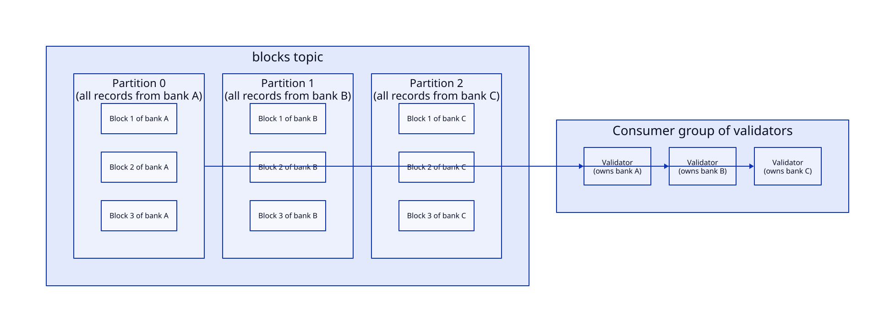

# Partitioning

How trades are routed to Kafka partitions, and why this is what makes the [credit model](../credit-model/) safe without locks (thesis §3.2.4, §4.1).

## The rule: every balance has exactly one owner

If two validators could update the same account, they could both read the same old balance and overwrite each other's result (a dirty write). The design rules this out structurally:

- **All trades touching an account go to the same partition:** outgoing trades when they are validated, and credits when they are applied.
- **Each partition is consumed by exactly one validator**, through Kafka consumer groups.
- So each balance is only ever read and written by one validator. **No locks or remote balance lookups are needed between validators.**

The alternative without this rule would be to re-read the latest balance from `localBalance` before every trade, which would add a round trip per trade.

Source: [`diagrams/blocks-partitioning.d2`](diagrams/blocks-partitioning.d2) (thesis Fig. 3.3)

## Unit of partitioning: the bank

The smallest correct unit would be the account, but **one partition per account doesn't scale**: thousands of partitions overload the brokers and slow down consumer polling. Instead:

- Accounts are grouped, and the natural group is the **bank**: one bank = one partition.
- **Partition count ≈ number of validators** in the consumer group, which is the maximum useful parallelism.
- This matches the envisioned deployment: each bank runs its own broker, aggregator and validator at its headquarters (thesis §4.1.1). The thesis assumes banks of similar size. Grouping by bank isn't mandatory; any account grouping works as long as one group maps to one partition.

## Sender side, then receiver side

A trade is partitioned twice in its life:

| Phase | Partitioned by | Field used |
|---|---|---|
| Validation | **Sender's** bank | `outbankPartition` |
| Credit | **Receiver's** bank | `inbankPartition` |

After validation, the receiver's attributes take over the partitioning role. The trade's `category` changes from *send* to *receive*. This matters in the Sequential model, where both kinds share the `blocks` topic (see [models](../models/)).

## Topic partitioning

| Topic | Partitions | Key / routing |
|---|---|---|
| `trades` | One per aggregator | No key (Kafka spreads records over partitions). Trades arrive unsorted, and any aggregator may take any trade. |
| `blocks` | One per bank (= validators) | Sender bank for new trades; receiver bank for credits (Sequential model) |
| `credits` | Same as `blocks` | Receiver bank. Validators are assigned the **same banks** on `blocks` and `credits`. |
| `orders` | Same as `blocks` (optional) | Bank. Lets validators write results in parallel; a single partition would also work. |
| `localBalance` | Same as `blocks` (compacted) | Bank, so a validator can rebuild exactly the balances it owns. The record key is the account. |
| `validatorOffsets` | Same as `blocks` (compacted) | Bank. How far the bank's validator has read `blocks` and `credits` (key: the topic name). |
| `accountInfo` | 1 | Written once by `init`, read by every role at startup |

Aggregators aren't tied to banks: one aggregator can build blocks for several banks within the same timeout window.

## Rebalancing and recovery

When a validator fails, or a new one joins, the consumer group **reassigns partitions**. Only `blocks` is assigned by the group. In the Concurrent model, the validator's `credits` consumer follows whatever `blocks` partitions it holds, so a bank's two sides always move together.

The validator that receives a bank first fences the bank's previous owner, then rebuilds that bank's balances from `localBalance` and continues from the position recorded in `validatorOffsets`. See [consistency](../consistency/#recovery).

## Ordering consequences

- Within one partition (one bank), records are strictly ordered.
- Across partitions there is no global order, so the system is **not linearizable**, but it is serializable within a bank. Details are in [consistency](../consistency/#ordering).
- Partitioning `orders` by bank trades inter-bank serializability for parallel writes. The thesis considers intra-bank order the important one.
